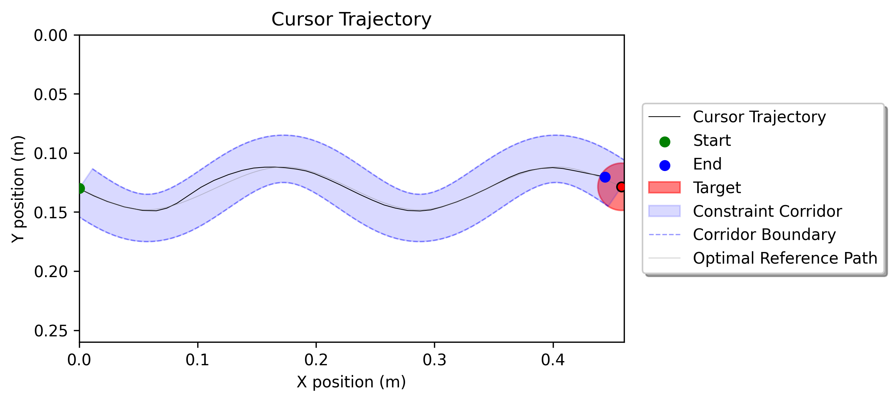
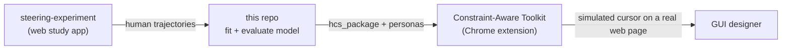
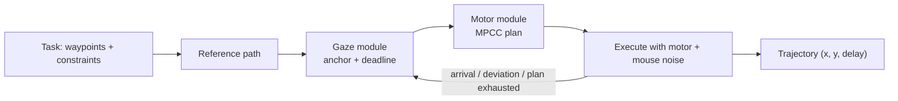

# Adaptive Cursor Trajectory Simulator

This project simulates how a person moves a mouse cursor through an interface.
You give it a path to follow and the regions the cursor must stay inside or
avoid, such as a tunnel, a cascading menu or a target. It returns a timed
cursor trajectory with human-like speed changes, corner cutting and motor
noise.

You can use the trajectories to:

- estimate how hard a GUI layout is to use before running a user study;
- drive a browser with realistic mouse input, for example with Playwright;
- study steering and pointing behaviour against recorded human data.



*The simulator steering through a sinusoidal tunnel (`office_worker` persona).
Black: cursor trajectory. Grey: reference path. Blue band: the tunnel. Red disc: the target.*

## Related repositories

This repository holds the model and the research code. Two companion
repositories cover data collection and design use:

| Repository | What it is | Use it to |
|---|---|---|
| **adaptive-cursor-trajectory-simulator** (this repo) | The simulator (`hcs_package`), model fitting, and evaluation against human data | Generate trajectories, fit the model, reproduce analyses |
| [**steering-experiment**](https://github.com/KevinXiangyuZhou/steering-experiment) | A React web app for the user study: tunnel-steering trials with cursor-trajectory logging and optional Firebase upload | Collect human steering data (`npm install`, `npm run dev`) |
| [**Constraint-Aware-Toolkit-for-WebGUI-Design**](https://github.com/KevinXiangyuZhou/Constraint-Aware-Toolkit-for-WebGUI-Design) | A Chrome extension backed by a local FastAPI server. It bundles a copy of `hcs_package` | Draw waypoints and keep-in / keep-out zones on any web page, run the simulator, and replay a "ghost cursor". See its [SETUP.md](https://github.com/KevinXiangyuZhou/Constraint-Aware-Toolkit-for-WebGUI-Design/blob/main/SETUP.md) |

The pieces fit together like this:



## How the model works

The simulator alternates between looking ahead and moving, the way people do
when they steer a cursor along a path.

1. **Reference path.** The waypoints and constraints become a smooth path
   that cuts corners where the corridor allows it.
2. **Gaze module: where to look and how long to take.** At each planning event
   the eyes pick an *anchor* point ahead on the path. Narrow sections shorten
   the look-ahead and wide sections lengthen it, so that each look covers a
   fixed amount of "difficulty". A speed model fitted to human data sets the
   time allowed to reach the anchor.
3. **Motor module: how to get there.** A model-predictive contouring
   controller (MPCC) plans a smooth, low-jerk movement that reaches the anchor
   by that deadline and stays inside the allowed regions. Speed is not
   prescribed. It follows from look-ahead distance divided by deadline.
4. **Execution with noise.** The cursor follows the plan with
   signal-dependent motor noise and a mouse transfer function. A new plan
   starts when the cursor reaches the anchor (after a short reaction latency),
   drifts too far from the plan, or runs out of plan.



The code for each step lives in
[`hcs_package/src/hcs_package/`](hcs_package/src/hcs_package/):
[`reference_path.py`](hcs_package/src/hcs_package/reference_path.py),
[`gaze_module.py`](hcs_package/src/hcs_package/gaze_module.py) with
[`intermittent.py`](hcs_package/src/hcs_package/intermittent.py),
[`motor_module.py`](hcs_package/src/hcs_package/motor_module.py) with
[`mpcc_model.py`](hcs_package/src/hcs_package/mpcc_model.py), and
[`noise.py`](hcs_package/src/hcs_package/noise.py).
[`cursor_simulator.py`](hcs_package/src/hcs_package/cursor_simulator.py) ties
them together.

## Installation

Use Python 3.10 or newer (tested on 3.10 and 3.12).

```bash
git clone https://github.com/KevinXiangyuZhou/adaptive-cursor-trajectory-simulator.git
cd adaptive-cursor-trajectory-simulator

python -m venv .venv
source .venv/bin/activate          # Windows: .venv\Scripts\activate

pip install -e hcs_package         # the simulator
pip install -r requirements.txt seaborn   # replay viewer and plots
```

Install the package in editable mode (`-e`). The built-in personas and fitted
speed models are read from the source tree.

For model fitting, also run `pip install cma pandas`.

Check the install by running the package tests:

```bash
cd hcs_package && pytest tests/ -q
```

## Quick start

### 1. Watch a simulated trajectory

This command generates a trajectory, replays it in a pygame window, and saves
the trajectory and speed plots:

```bash
python -m experiment.pygame_experiment \
  --env-config experiment/environment_configurations/sigmoidal_tunnel.json \
  --user-config hcs_package/src/hcs_package/user_configurations/office_worker.json
```

`--user-config` is required. Plots go to
`results/<date>_<task>_experiment/run_<time>/` unless you pass `--save-path`.

Other tasks in
[`experiment/environment_configurations/`](experiment/environment_configurations/):

| Config | Task |
|---|---|
| `straight_tunnel.json` | Straight tunnel |
| `sigmoidal_tunnel.json` | Sinusoidal tunnel |
| `corner_tunnel.json` | Tunnel with a sharp corner |
| `wide_to_narrow.json` | Tunnel that narrows partway |
| `cascading_menu.json` | Cascading menu navigation |
| `lasso_selection.json` | Lasso selection |
| `unconstrained_pointing_mpcc.json` | Point-to-point pointing (the `_t42` … `_t55` files vary the target) |

### 2. Generate a trajectory in Python

```python
from hcs_package import CursorSimulator

SCREEN_W, SCREEN_H = 1920, 1080
PX_TO_M = 0.46 / SCREEN_W            # the simulator's screen is 0.46 m wide

# Points to pass through, in screen pixels.
waypoints = [(200, 540), (960, 300), (1700, 540)]

# A 30 mm wide tunnel along the same points. Constraints are in metres.
constraints = {
    "coordinate_system": "normalized",
    "regions": [{
        "constraint_type": "keep_in",
        "geometry": {
            "type": "path",
            "path": [[x * PX_TO_M, y * PX_TO_M] for x, y in waypoints],
            "width": 0.03,
        },
    }],
}

sim = CursorSimulator("office_worker")
trajectory = sim.generate_trajectory_with_waypoints(
    waypoints=waypoints,
    constraints=constraints,
    screen_width=SCREEN_W,
    screen_height=SCREEN_H,
)

for x, y, delay in trajectory:       # pixels, pixels, seconds until next point
    print(f"{x:7.1f} {y:7.1f}  wait {delay:.2f}s")
```

To drive a browser, feed the points to Playwright:

```python
for x, y, delay in trajectory:
    await page.mouse.move(x, y)
    await page.wait_for_timeout(int(delay * 1000))
```

Useful options of `generate_trajectory_with_waypoints`:

- `task_file="task.json"`: read waypoints, constraints and screen size from a
  JSON file instead. See [`hcs_package/tests/test_task.json`](hcs_package/tests/test_task.json).
- `target_radius=0.01`: how close to the last waypoint counts as arrival, in metres.
- `return_timestamps=True`: return absolute times instead of delays.
- `return_reference_path=True`: also return the planned reference path.

### Units

| Quantity | Unit |
|---|---|
| Waypoints and returned `x`, `y` | Screen pixels |
| Constraint geometry, `target_radius` | Metres on a virtual screen 0.46 m wide; height scales with the screen's aspect ratio |
| Returned delays | Seconds |

### Constraint shapes

Each entry in `regions` has a `constraint_type` (`keep_in` or `keep_out`) and
a `geometry`:

| `geometry.type` | Fields | Example use |
|---|---|---|
| `path` | `path` (list of points), `width` | Tunnels, sliders, drag paths |
| `rectangle` | `x`, `y`, `width`, `height` | Menu panels, buttons, no-go areas |
| `polygon` | `vertices` (list of points) | Irregular regions |

All constraints are soft penalties in the planner's cost.

## Personas

A persona is a JSON file of model parameters. Pass a built-in name or a file
path to `CursorSimulator`.

| Persona | Motor noise `nc` | Forearm (m) |
|---|---|---|
| `office_worker` (default) | 0.20, 0.020 | 0.35 |
| `gamer` | 0.10, 0.010 | 0.36 |
| `novice` | 0.26, 0.026 | 0.357 |
| `fatigued` | 0.25, 0.025 | 0.35 |
| `motor_impaired` | 0.40, 0.040 | 0.35 |
| `young_children` | 0.36, 0.036 | 0.22 |

The built-in personas share planner weights and gaze parameters. They differ
mainly in motor noise and forearm length. Their noise values come from an
earlier model version and have not yet been refitted. They are illustrative
profiles, not fits to specific user groups.

The persona fitted to the pooled human data and used in the evaluations is
[`eval-14p/personas/pooled8-991900f/default.json`](eval-14p/personas/pooled8-991900f/default.json):

```python
sim = CursorSimulator("eval-14p/personas/pooled8-991900f/default.json")
```

To make your own, copy a persona JSON, edit it, and pass its path. Main keys:

| Key | Meaning |
|---|---|
| `nc` | Motor noise: [along-movement, perpendicular] |
| `forearm` | Forearm length (m); shapes the mouse transfer function |
| `planner_weights` | MPCC cost weights: `jerk` (smoothness), `contour` (path tracking), `constraint` (boundaries), `goal` (drive toward the anchor) |
| `budget` | Gaze look-ahead: difficulty budget `D0`, width exponent `gamma`, minimum look-ahead time `T_min` |
| `replan_latency_s`, `replan_deviation_frac` | When a new plan starts |
| `reference_path` | Corner-cutting parameters |
| `speed_model` | `{"type": "gam_traversal"}` uses the shipped pooled speed model; add `"path"` for another |
| `add_noise`, `random_seed` | Turn noise off; make runs repeatable |

> Note: the configuration section of [`hcs_package/README.md`](hcs_package/README.md)
> describes an older design (`"speed_model": {"type": "gam"}`). The current code
> refuses that setting. Use the shipped persona files as templates.

## Reproducing the research

This part is for readers who want to refit or re-evaluate the model. Fitting
is compute-heavy. The scripts were run on the University of Michigan Great
Lakes SLURM cluster.

| Step | Entry point |
|---|---|
| Fit one participant | `python eval/eval-anchor-drive/fit_anchor.py --pid p01` |
| Fit the pooled model | `eval/eval-anchor-drive/fit_anchor_pooled8.py` |
| Evaluate against human data | `python eval/eval-main/run_eval.py --help` |
| Evaluate on 14 new participants | `eval-14p/run_local.sh --pid <id>` (see [`eval-14p/README.md`](eval-14p/README.md)) |
| Full fit, evaluate, aggregate on the cluster | `./submit_run.sh --model mpcc --variant full --kind pooled8` |

Before running on the cluster, run `setup.sh` once on the login node.
`submit_run.sh` explains all options in its header. It writes each run to its
own directory with a snapshot of the code. Its results path defaults to the
author's cluster directory; set `RESULTS_ROOT` to change it. The older
top-level `fit_*.sh` and `eval_*.sh` scripts are retired.

Model fits and results are not in git (`results/`, `results-*/`).

## Repository layout

| Path | Contents |
|---|---|
| [`hcs_package/`](hcs_package/) | The simulator as an installable Python package, with personas, fitted speed models and tests |
| [`experiment/`](experiment/) | Task definitions and the pygame replay viewer |
| [`human_data/`](human_data/) | Recorded human data: raw sessions, gaze-cursor recordings, cleaned fixation events ([README](human_data/processed_gaze_events/README.md)), task-aligned tables |
| [`eval/`](eval/) | Fitting and analysis: main evaluation (`eval-main`), anchor-drive fitting (`eval-anchor-drive`), gaze analyses (`eval-gaze-cursor`, `eval-gaze-lead`), baselines, shared `utils/` |
| [`eval-14p/`](eval-14p/) | Generalisation test of the pooled model on 14 new participants |
| [`cluster/`](cluster/), [`greatlakes_instructions/`](greatlakes_instructions/) | SLURM job scripts and notes on the cluster |
| [`paper/`](paper/) | Scripts for paper figures, tables and statistics |
| `participants*.txt` | Participant lists for batch fitting and evaluation |

## License

`hcs_package` is released under the MIT License (see
[`hcs_package/pyproject.toml`](hcs_package/pyproject.toml)).
